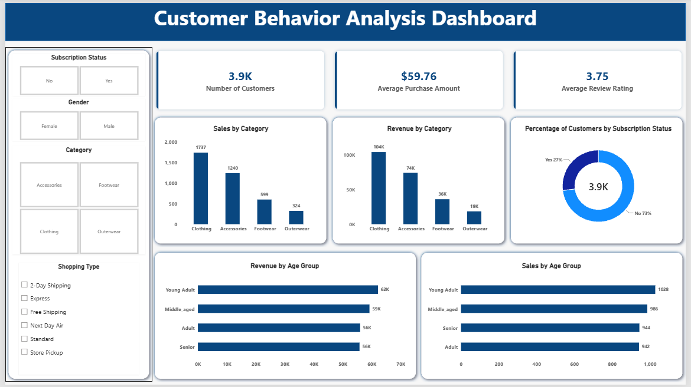

# Customer Shopping Behaviour Analysis

An end-to-end retail customer analytics project using **Python**, **PostgreSQL**, and **Power BI**. It prepares customer shopping data, answers business questions with SQL, and presents customer, category, subscription, and age-group metrics in an interactive dashboard.

## Project overview

The project turns customer shopping records into a repeatable analytics workflow: Python prepares the data, PostgreSQL queries investigate customer and product behavior, and Power BI presents the results with KPI cards, charts, and slicers.

## Dataset summary

| Item | Summary |
|---|---|
| Records | 3,900 customer purchase records |
| Original fields | 18 columns |
| Measures | Purchase amount (USD), review rating, and previous purchases |
| Dimensions | Age, gender, item, category, location, size, color, season, shipping, subscription, discounts, payment method, and purchase frequency |
| Data quality | 37 review ratings are missing; the notebook fills them with the median rating within each product category. Other source columns have no missing values. |

The dataset has no transaction date, so this project compares customer and product groups rather than sales trends over time.

## Work performed

### Python: preparation and validation

- Loaded the CSV into pandas and reviewed its structure, descriptive statistics, and missing values.
- Imputed missing review ratings with each category's median.
- Standardized column names, created age quartiles, and mapped purchase-frequency labels to approximate days.
- Checked that `Promo Code Used` matched `Discount Applied` for every row, then removed the duplicate field.
- Loaded the prepared DataFrame into PostgreSQL with SQLAlchemy.

### SQL: business analysis

`Customer_behavior_analysis.sql` contains PostgreSQL queries for:

- Revenue by gender, age group, category, and subscription status.
- Average purchase amount by shipping method and subscription status.
- Discount users who spent at least the overall average.
- Highest-rated products and products with the highest discount rates.
- New, returning, and loyal customer segments.
- Top three products within each category using `ROW_NUMBER()`.
- Subscription status among repeat buyers.

### Power BI: interactive reporting

`Customer_behaviour_analysis_dashboard.pbix` includes:

- KPI cards for customer count, average purchase amount, and average review rating.
- A subscription-status split.
- Revenue and customer counts by product category.
- Revenue and customer counts by age group.
- Slicers for subscription status, gender, category, and shipping type.

## Dashboard preview

The screenshot below shows the one-page Power BI dashboard, including the customer KPIs, subscription split, category performance, and age-group comparisons. Open the PBIX file in Power BI Desktop to use its interactive slicers.

## Key findings

- The dataset contains **3,900 records** and **$233,081** in recorded purchase amount; average purchase amount is **$59.76**.
- **Clothing** leads category revenue at **$104,264 (44.7%)**, followed by Accessories at $74,200 (31.8%).
- **27.0%** of records are from subscribers. Their average purchase amount ($59.49) is slightly below that of non-subscribers ($59.87) in this snapshot.
- Discount-applied purchases average **$59.28**, compared with **$60.13** for purchases without a discount. The data does not show a higher average purchase amount among discount users.
- Express-shipping purchases average **$60.48**, versus **$58.46** for Standard shipping.
- Young Adult customers contribute the highest age-group revenue ($62,143), while average purchase amounts across age groups are close (about $59-$60).

## Recommendations

1. **Test subscription benefits.** Subscribers are about 27% of records and do not have a higher average purchase amount in this dataset. Use a controlled test and track repeat frequency, retention, and margin before expanding offers.
2. **Measure promotion lift.** Discounted purchases have a slightly lower average amount here. Compare matched or randomized groups and include gross margin to determine whether discounts create incremental value.
3. **Prioritize category execution.** Clothing contributes the largest revenue share; maintain availability of high-volume products and test relevant cross-sells into Accessories.
4. **Add transaction dates for trend analysis.** A dated transaction history would support seasonality, cohort retention, and campaign-period comparisons that this snapshot cannot provide.

## Project files

- [Python analysis and preparation](Customer_Shopping_Behaviour_Analysis.ipynb)
- [PostgreSQL analysis queries](Customer_behavior_analysis.sql)
- [Power BI dashboard](Customer_behaviour_analysis_dashboard.pbix)
- [Power BI dashboard screenshot](previews/customer_behavior_dashboard.png)

## Running the project

1. Install Python dependencies: `pandas`, `SQLAlchemy`, and a PostgreSQL driver such as `psycopg2-binary`; use Jupyter to open the notebook.
2. Place `customer_shopping_behavior.csv` somewhere accessible and update the notebook's `pd.read_csv()` path. The CSV is not included in the three provided project files.
3. Configure a PostgreSQL database and local credentials, run the notebook load step, and execute the SQL file against the `customer` table.
4. Open the PBIX file in Power BI Desktop.

### Reproducibility notes

- The notebook currently contains a machine-specific CSV path and local database connection settings. Replace these with local configuration before running or sharing the notebook; do not commit passwords.
- PostgreSQL folds unquoted identifiers to lowercase. The notebook renames the purchase amount field to `Purchase_amount`, while the SQL file refers to `purchase_amount`; align the column name or quote it consistently before running the SQL queries.
- Findings above summarize this CSV snapshot. They are descriptive and do not establish that discounts, shipping, or subscriptions caused changes in spending.
